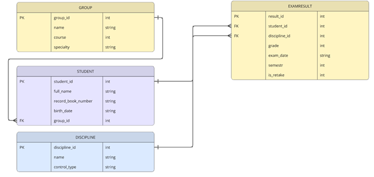

# Система учёта результатов промежуточной аттестации студентов

Проект представляет собой консольное Python-приложение для автоматизации учёта результатов промежуточной аттестации студентов с использованием СУБД SQLite и архитектурного шаблона многослойного приложения (Layered Architecture).

## Описание предметной области

Система предназначена для работы сотрудника деканата / учебного отдела и позволяет:
* Находить и просматривать списки студентов, их группы и зачётные книжки.
* Учитывать и регистрировать результаты экзаменационных сессий и пересдач.
* Безопасно разграничивать доступ к операциям на основе ролей пользователей системы.
* Выгружать связанные данные из базы в форматы `JSON`, `CSV`, `XML` и `YAML` для обмена и отчётности.

## Архитектура приложения

Проект построен по принципу разделения ответственности (Separation of Concerns) и состоит из независимых слоёв и модулей:

1. **`models/` (Слой моделей данных):**
   * Содержит классы на основе `@dataclass` (`User`, `Student`, `ExamResult`, `Group`, `Discipline`).
   * Преобразует кортежи из базы данных SQLite в объекты Python с явной типизацией и вычисляемыми полями.

2. **`repositories/` (Слой доступа к данным):**
   * Отвечает за выполнение SQL-запросов (CRUD-операции и `JOIN`-выборки) через модуль `sqlite3`.
   * Содержит `user_repository`, `student_repository`, `exam_repository` и др.
   * Исключает хранение SQL-запросов в бизнес-логике и интерфейсе.

3. **`services/` (Слой бизнес-логики):**
   * Выполняет валидацию данных (проверка диапазонов оценок 2–5, заполненность обязательных полей).
   * Координирует работу нескольких репозиториев.
   * Выполняет авторизацию и проверку существования сущностей перед записью.

4. **`ui/` (Слой пользовательского интерфейса):**
   * Консольное меню (`main_menu.py`) и форма авторизации (`auth_ui.py`).
   * Перехватывает ошибки и исключения (`try-except`), исключая аварийное завершение программы.
   * Проверяет роль авторизованного пользователя перед предоставлением доступа к операциям записи.

5. **Экспорт данных (`export_data.py`):**
   * Выполняет параметризованную выгрузку данных из БД (включая объединение таблиц через `JOIN`) в `JSON`, `CSV`, `XML` (с форматированием отступов) и `YAML`.
   * Сохраняет результаты в директорию `out/` в корне проекта.

## Схема базы данных (ER-диаграмма)

Основные сущности базы данных:
* **`UserRole`** — роли пользователей системы.
* **`User`** — сотрудники системы, заходящие под логином и паролем (администратор, сотрудник деканата).
* **`Group`** — учебные группы студентов.
* **`Student`** — студенты (ФИО, зачётная книжка, дата рождения, ссылка на группу).
* **`Discipline`** — учебные дисциплины.
* **`ExamResult`** — оценки за экзамены, связывающие студента и дисциплину.



## Структура проекта

```text
Project/
├── database/               # Модуль подключения и файл БД
│   ├── database.py         # Функция get_connection() для SQLite
│   └── database.db         # Файл базы данных
├── src/
│   ├── models/             # Слой моделей данных (Dataclasses)
│   ├── repositories/       # Слой доступа к данным (SQL / CRUD)
│   ├── services/           # Слой бизнес-логики и проверок
│   └── ui/                 # Пользовательский консольный интерфейс
├── docs/
│   └── diagrams/
│       └── er_diagram.png
├── out/                    # Результаты экспорта (создаётся при запуске export_data.py)
│   ├── data.json
│   ├── data.csv
│   ├── data.xml
│   └── data.yaml
├── export_data.py          # Скрипт экспорта данных в JSON, CSV, XML и YAML
├── init_db.py              # Скрипт автоматической инициализации БД
├── main.py                 # Точка входа в приложение
├── schema.sql              # SQL-скрипт создания структуры и наполнения БД
└── README.md               # Описание проекта