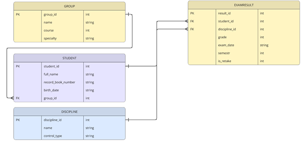

# Лабораторная работа : C++ Проект

## Описание проекта
Данный проект разработан на языках **C++ и Python** в среде **Visual Studio Code**. 

**Предметной областью данной системы** является процесс фиксации, хранения и обработки результатов промежуточной аттестации (экзаменационной сессии) студентов в высшем или среднем специальном учебном заведении.

**Основная цель системы** — автоматизация работы деканата или учебного отдела по сбору, учету успеваемости и формированию итоговой отчетности.

**Что учитывается и отслеживается в системе**
В системе фиксируются ключевые сущности учебного процесса и связи между ними:
1.	Студенты:
    *	Личные данные (ФИО, дата рождения).
    *	Номер зачетной книжки / студенческого билета (уникальный идентификатор).
    *	Учебная группа, курс, специальность/направление подготовки.

**Главная цель разработки системы** — автоматизация процесса учета, обработки и анализа результатов экзаменационных сессий студентов для повышения эффективности работы учебного отдела (деканата), исключения ошибок, связанных с человеческим фактором, и обеспечения оперативного доступа к достоверной информации об успеваемости студентов.

**Список основных функций, которые система должна выполнять**:
1. Ввод и редактирование базовых данных:
    *	Актуализация сведений о студентах (ФИО, номер зачетной книжки, статус).
    *	Ведение справочника учебных дисциплин с указанием формы контроля.
2. Учет результатов промежуточной аттестации:
    *	Фиксация и редактирование оценок за экзамены и дифференцированные зачеты.
    *	Ведение учета ликвидации академических задолженностей (пересдач).


## База данных
В проекте используется встроенная СУБД **SQLite**.

## Схема базы данных (ER-диаграмма)
В рамках лабораторной работы была спроектирована ER-диаграмма, отражающая основные сущности учебного процесса и связи между ними:
- **Group** — учебные группы.
- **Student** — студенты (связана с `Group` как 1:N).
- **Discipline** — учебные дисциплины.
- **ExamResult** — результаты экзаменационной сессии (связана с `Student` и `Discipline` как 1:N).





## Структура и инициализация БД
- `schema.sql` — SQL-скрипт для создания структуры таблиц, описания ограничений (PK, FK) и заполнения тестовыми данными.
- `init_db.py` — Python-скрипт автоматической инициализации базы данных.

Для создания/пересоздания базы данных `database.db` выполните команду:
```bash
python init_db.py
```

## Структура проекта
* `src/` — исходный код C++ (`main.cpp`)
* `docs/diagrams/` — диаграммы PlantUML, блок-схемы и ER-диаграмма
* `schema.sql` — SQL-скрипт создания таблиц и начальных данных
* `init_db.py` — скрипт инициализации базы данных на Python
* `database.db` — файл базы данных SQLite